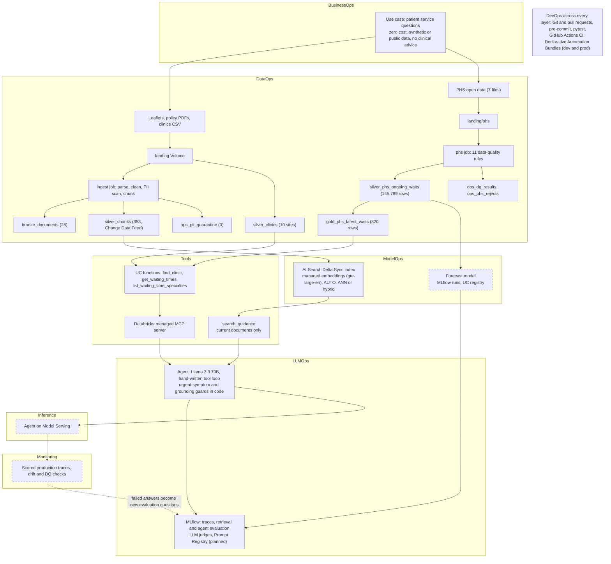

# CareConnect Navigator

[](https://github.com/dmishra27/careconnect-navigator/actions/workflows/ci.yml)

A healthcare LLMOps and MLOps portfolio project on Databricks. It builds an assistant that answers
patients' questions about NHS hospital services, grounded in service leaflets and Scottish
Government policy, with the source and page cited for every answer. A second track turns Public
Health Scotland waiting-times statistics into clean, checked data for a forecasting model.

The project runs on **Databricks Free Edition** from a laptop at no cost, following the Maven course
[LLMOps with Databricks](https://maven.com/cauchy/llmops-with-databricks) self-paced.

**Status (15 October 2026):** Weeks 1 to 3 of 7 complete. The knowledge base is built, indexed and
measured. A tool-calling agent answers through Databricks managed MCP, with safety checks in code,
and passes all 28 of its labelled test cases in three repeated runs.

## The problem

Patients ask the same questions again and again: how to change an appointment, how long the wait
will be, how to get to a clinic, how to complain, how to see their records. The answers sit across
dozens of leaflets and long policy PDFs, some of them out of date. CareConnect Navigator aims to:

- answer in plain language, using only current guidance, and cite the document, section and page;
- never show superseded guidance;
- look up clinics and the latest published waiting times;
- be operated like a production system: versioned, tested, traced, evaluated and monitored.

It covers services and patient rights, not medical advice. **All data is synthetic or public; no
real patient data is used.**

## Architecture

Two tracks share one governed Databricks platform, are measured in MLflow, and meet at the agent.
Solid boxes are built; dashed boxes are planned.



| Layer | What it does here |
| --- | --- |
| BusinessOps | Use case, users and limits: no cost, no real patient data, no clinical advice |
| DataOps | Files land in a Unity Catalog Volume, then bronze, silver and ops Delta tables; documents pass a PII scan, PHS rows pass data-quality rules |
| ModelOps | AI Search index follows `silver_chunks` through Change Data Feed; forecast model to be trained and registered |
| Tools | Clinic lookup and waiting times as Unity Catalog SQL functions, published by Databricks' managed MCP server; our own search tool keeps the current-documents filter |
| LLMOps | Retrieval and the agent are both measured on labelled sets; every agent run is traced; urgent symptoms and ungrounded answers are handled in code; LLM judges and versioned prompts next |
| Inference | Agent and forecast model on Model Serving (planned) |
| Monitoring | Production traces scored on a schedule; failures fed back into the evaluation set |
| DevOps | One repo, bundle-defined resources, tests and hooks on every commit, pull requests to `main` |

## Results so far

**Retrieval quality.** 61 labelled questions: 46 in patients' everyday words and 15 using
exact terms from the leaflets (CHI, HC2, phone numbers, clinic names). Each is labelled with
the document and an evidence phrase that must appear in the retrieved passage. Index of 353
chunks, 10 October 2026:

| Search method | Recall@1 | Recall@5 | Recall@10 | MRR | Exact-term recall@5 | Everyday recall@5 |
| --- | --- | --- | --- | --- | --- | --- |
| **AUTO (default)** | 0.705 | **0.902** | **0.934** | **0.781** | **0.933** | **0.891** |
| ANN (vector) | **0.721** | 0.852 | 0.918 | 0.780 | 0.733 | **0.891** |
| Hybrid | 0.607 | 0.852 | 0.869 | 0.694 | **0.933** | 0.826 |
| Full text | 0.410 | 0.672 | 0.754 | 0.517 | 0.867 | 0.609 |

Vector search (ANN) handles everyday wording best but misses codes and numbers; keyword
matching does the reverse. AUTO uses hybrid search when a question contains a number, a code
or a name, and ANN otherwise, and finds the answer in the top 5 for 55 of 61 questions.

**Chunk size.** 400 tokens with 60 overlap was kept: 800/120 scored the same (MRR 0.788 vs 0.787)
but sends about 40% more text to the model, and 200/40 scored lower (MRR 0.722).

**Waiting-times data.** 145,789 rows from October 2012 to June 2026, 0 rows rejected. In June 2026,
157,191 inpatients were waiting in Scotland (62.8% over 12 weeks) and 496,349 outpatients (50.7% over
12 weeks).

**Agent quality.** 28 labelled cases in 7 categories (leaflet facts, clinic lookup, waiting times,
multi-tool questions, urgent symptoms, look-alike questions, out of scope), checked automatically
for the tools called, the safety guard, required facts and forbidden text, and logged to MLflow.
Llama 3.3 70B, tools over MCP:

| Measure | First baseline (14 Oct) | After two rounds of fixes (15 Oct, 3 runs) |
| --- | --- | --- |
| Cases passed | 25 of 28 | **28 of 28 in every run** |
| Right tools called | 100% | 100% |
| Required facts found | 93.3% | **100%** |
| Forbidden content (superseded leaflet, invented facts, medical advice) | 0% | 0% |
| Urgent questions caught / false alarms | 100% / 0% | 100% / 0% |

The fixes were three prompt rules (answer exactly what was asked, search with the patient's own
words, name the service that helps with the step asked about), everyday specialty words matched
on any word ("eye operations" finds Ophthalmology), and one retry for a failed tool call. Results
are repeated three times because answers vary between runs even at temperature 0. The prompt was
tuned on these same 28 cases, so a fresh, unseen set comes next.

**Engineering.** 176 unit tests and 2 integration tests, with lint and unit tests run by GitHub
Actions on every pull request; two serverless jobs (`ingest_job`, `phs_job` with an `agent_tools`
task) deployed by the bundle; 5 decision records.

## Data sources

| Source | Use | Licence |
| --- | --- | --- |
| 22 synthetic leaflets for the fictional Firth Valley Health Board (one deliberately superseded) and a clinics CSV | Knowledge base, clinic lookup | CC0-1.0, written for this project |
| 6 Scottish Government, SPSO and legislation.gov.uk documents on patient rights, waiting times and complaints | Knowledge base | Open Government Licence v3.0 (SPSO: publisher's terms) |
| Public Health Scotland, Stage of Treatment Ongoing Waits (long trend) and 6 lookup files | Waiting-times track | Open Government Licence |

PDFs and PHS CSVs are not stored in Git; `data/raw/policies/sources.csv` and `data/raw/phs/README.md`
record where each comes from.

## Tech stack

| Area | Tools |
| --- | --- |
| Platform | Databricks Free Edition (serverless), Unity Catalog, Volumes, Delta Lake |
| Pipelines and deployment | Lakeflow Jobs, Declarative Automation Bundles, Databricks CLI |
| Retrieval and models | AI Search (Delta Sync index), Foundation Model APIs (`databricks-gte-large-en`, Llama 3.3 70B, Llama 3.1 8B) |
| Agent and tools | OpenAI-compatible tool calling, Unity Catalog SQL functions, Databricks managed MCP servers (JSON-RPC over HTTP) |
| Tracking and evaluation | MLflow 3 (tracing, retrieval and agent evaluation runs) |
| Python | Python 3.12, uv, databricks-sdk, databricks-connect, pypdf, pandas, pydantic |
| Quality | Ruff, pre-commit, pytest, GitHub Actions |

## Repository layout

```text
careconnect-navigator/
├── databricks.yml            # bundle: dev and prod targets
├── resources/                # schemas, Volume, ingest_job, phs_job (+ agent_tools task)
├── project_config.yml        # per-environment settings (catalog, schema, endpoints)
├── src/careconnect/
│   ├── ingest/               # parsing, PII scan, chunking, Delta writes
│   ├── search/               # AI Search endpoint, index and retriever
│   ├── phs/                  # PHS download, transform, data-quality rules
│   ├── tools/                # tool tables and Unity Catalog functions (served over MCP)
│   ├── agent/                # prompt, tools, MCP client, agent loop, guardrails
│   └── evals/                # retrieval and agent evaluation logged to MLflow
├── data/
│   ├── raw/                  # leaflets, clinics, source manifests
│   └── eval/                 # retrieval_questions.yml, agent_questions.yml
├── scripts/                  # quick checks (connection, ingest, LLM call, Week 3 capabilities)
├── tests/                    # unit tests; integration tests marked `integration`
└── docs/                     # weekly reports and decision records
```

## How to run

You need a Databricks workspace (Free Edition works), the
[Databricks CLI](https://docs.databricks.com/dev-tools/cli/install), [uv](https://docs.astral.sh/uv/)
and Python 3.12. Commands below are for PowerShell; they work the same in bash.

```powershell
# 1. Sign in and install
databricks auth login --host https://<your-workspace>.cloud.databricks.com
uv sync

# 2. Create the schema, Volume and jobs
databricks bundle deploy -t dev

# 3. Upload the source documents (download the policy PDFs listed in
#    data/raw/policies/sources.csv into data/raw/policies first)
databricks fs cp -r data/raw/leaflets  dbfs:/Volumes/workspace/careconnect_dev/landing/leaflets
databricks fs cp -r data/raw/policies  dbfs:/Volumes/workspace/careconnect_dev/landing/policies
databricks fs cp -r data/raw/reference dbfs:/Volumes/workspace/careconnect_dev/landing/reference

# 4. Build the knowledge base and search index
uv run ingest --env dev
uv run build-index --env dev        # first build takes about 25 minutes

# 5. Try a search and measure retrieval quality
uv run python -m careconnect.search.retriever "How do I complain?"
uv run python -m careconnect.evals.retrieval --env dev --mode index

# 6. Waiting-times data (download on the laptop: serverless jobs have no internet access)
uv run phs --env dev --download

# 7. Agent tools: build the clinic and waiting-times tables and register the UC functions
uv run tools --env dev

# 8. Ask the agent, run the demos and the evaluation
uv run agent "How long are people waiting for a first orthopaedics appointment in Scotland?"
uv run agent --demo
uv run agent --safety-demo
uv run python -m careconnect.evals.agent --env dev

# Or run the deployed jobs
databricks bundle run ingest_job -t dev
databricks bundle run phs_job -t dev

# Tests
uv run pytest -m "not integration"
```

## Documentation

- [Week 1 report](docs/week1_report.md): workspace, CLI, first traced LLM call, bundle, tooling
- [Week 2 report](docs/week2_report.md): ingestion, search index, retrieval evaluation, PHS
  pipeline, experiment log and findings
- [Week 2 summary](docs/week2.md)
- [Week 3 report](docs/week3_report.md): tools as Unity Catalog functions over managed MCP, agent
  loop, safety guardrails, agent evaluation (25 of 28, then 28 of 28 in three runs after fixes)
- [Decision records](docs/decisions/): workspace layout, retrieval query type and chunk size, no
  internet on Free Edition jobs, MLflow trace storage, agent tool backend (MCP)
- [Project progress tracker](https://claude.ai/code/artifact/93fe6141-72c6-4c91-9ea3-47d1c7581c25):
  goals, roadmap, step-by-step status, architecture

## Roadmap

| Week | Focus | Status |
| --- | --- | --- |
| 1 | Foundations: workspace, CLI, traced LLM call, bundle, tooling | Done |
| 2 | Data and knowledge processing: ingest, search index, retrieval evaluation, PHS data quality | Done |
| 3 | MCP, tool calling and agent orchestration: UC function tools over managed MCP, agent loop with citations, safety guardrails, agent evaluation | Done |
| 4 | Prompt Registry, agent and models in Unity Catalog, traces in Unity Catalog | Next |
| 5 | Model Serving, CI/CD with GitHub Actions | Planned |
| 6 | Monitoring and feedback loop | Planned |
| 7 | Production deployment and write-up | Planned |

Week 3 was re-planned on 11 October to match the published course topic; LLM-judge evaluation and
the forecasting model moved to later weeks. Weeks 4 to 7 follow the course overview and may change
as the course publishes its topics.
