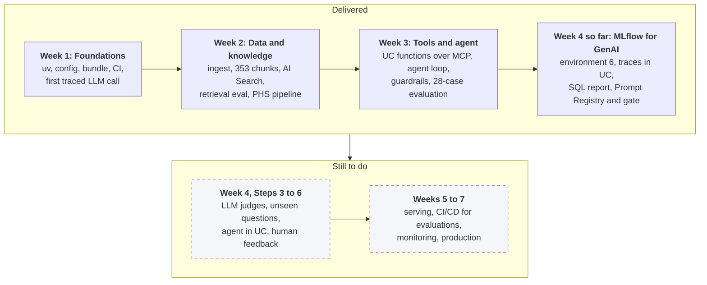
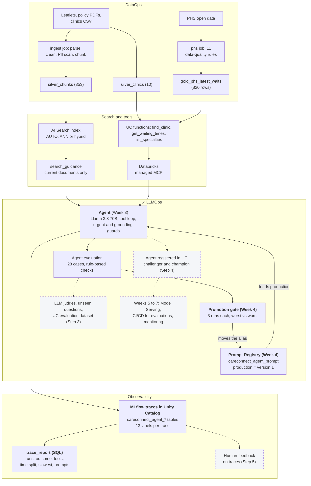
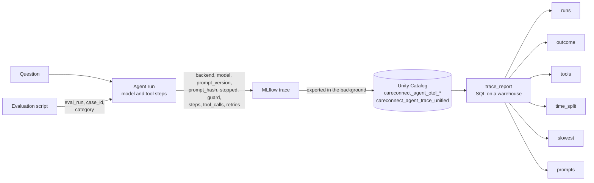
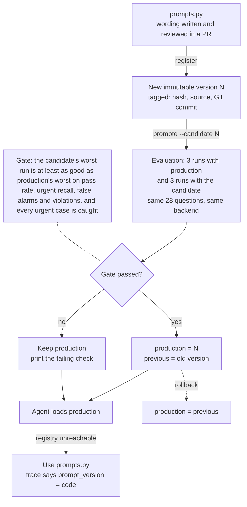

# CareConnect Navigator: Week 4 Progress Report

- **Project:** CareConnect Navigator (healthcare LLMOps and MLOps portfolio project)
- **Course week:** Week 4 of the Maven course "LLMOps with Databricks", 2 to 8 November 2026 (live session Wednesday 4 November, 15:00 to 17:00 GMT)
- **Course topic:** MLflow for GenAI
- **Work done:** 16 and 17 October 2026, about two and a half weeks ahead of the course calendar
- **Repository:** github.com/dmishra27/careconnect-navigator (`main` at commit 4b57b8c)
- **Status date:** 17 October 2026, end of day (interim: Steps 0 to 2 of 6 are done)

## 1. Summary

Week 4 is about running the agent like a production GenAI system with MLflow: knowing what it did on every question, versioning the prompt that drives it, judging its answers and registering it as a model. The first half is now done.

**Progress: 3 of the 7 planned steps (Steps 0, 1 and 2) are complete and merged (PRs #15, #16 and #17). Steps 3 to 6 have not started.** Two items carried over from Week 3 are closed: traces now go to Unity Catalog, and the prompt is in the Prompt Registry.

| Measure | Result | What it means |
| --- | --- | --- |
| Platform | **Serverless environment 6, MLflow 3.12**, 8 of 8 capability checks | The Week 3 blocker (Unity Catalog trace storage refused on MLflow 3.8.1) is gone |
| Agent quality after the upgrade | **28 of 28** on 16 Oct and again on 17 Oct | Nothing regressed when the platform changed |
| Traces in Unity Catalog | **226 traces** in `careconnect_agent_trace_unified` by the end of 17 Oct | Every question the agent answers is a row in a governed table |
| Labels on every trace | **13 labels** (run, case, category, backend, model, prompt version, prompt fingerprint, prompt source, outcome, guard, steps, tool calls, retries) | Any question about the agent becomes one SQL `GROUP BY` |
| SQL trace report | **6 tables** (runs, outcome, tools, time split, slowest, prompts) plus `--inspect` | Latency per tool, safety outcomes and prompt versions without opening a single trace |
| Prompt Registry | **Version 1 = production** (fingerprint `66201762873b`, identical to the code) | The prompt is versioned data, not only a Python string |
| Promotion gate | **Worked as designed:** a weaker version 2 failed one of three runs (case a13) and was **kept out of production** | A prompt change can only reach patients if it is at least as good on every run |
| Root cause of slow runs | **Tool lookups, not the model:** model calls 1.2 to 1.4 s throughout; some Unity Catalog function calls hung until the 120 s timeout (21 retries, 0 errors) | Found in the traces in minutes; fix is ready to build |
| Tests | **199 unit tests** (176 at the end of Week 3) | Every new path is covered offline |

## 2. Where Week 4 sits: Weeks 1 to 4

The project is one product built in layers. Each week adds a layer on top of the one before.

| Week | Course topic | What was delivered | Headline result | PRs | Tests |
| --- | --- | --- | --- | --- | --- |
| 1 (7 to 8 Oct) | Foundations | Workspace and CLI, uv project on Python 3.12, per-environment config, Declarative Automation Bundle, Ruff, pre-commit, pytest, first traced LLM call | Serverless job deployed and run from Git | #1 | 3 |
| 2 (9 to 10 Oct) | Data and knowledge processing | Ingest pipeline (parse, clean, PII scan, chunk), AI Search index, retrieval evaluation, PHS waiting-times pipeline with data-quality rules, CI | 28 documents, 353 chunks; AUTO search recall@5 **0.902** on 61 questions; 145,789 PHS rows, 0 rejects | #2 to #7 | 87 |
| 3 (11 to 15 Oct) | MCP, tool calling, agent orchestration | Unity Catalog function tools served over managed MCP, hand-written agent loop, safety guards in code, 28-case agent evaluation | **28 of 28** in 3 runs (baseline 25 of 28); 100% urgent recall; 0 false alarms | #8 to #14 | 176 |
| **4 (16 to 17 Oct, in progress)** | **MLflow for GenAI** | Environment 6 and MLflow 3.12; traces in Unity Catalog with labels and an SQL report; Prompt Registry with an evaluation gate | **28 of 28** on the registered prompt; gate kept production against a weaker candidate | **#15 to #17** | **199** |

## 3. Week 4 objectives and status

The plan was set on 15 October from the course topic "MLflow for GenAI". The forecasting model moved to a later MLOps week, and automatic prompt optimisation (`optimize_prompt`) is deferred until the evaluation is stronger.

| Step | Objective | What was delivered | Status |
| --- | --- | --- | --- |
| 0 | Move to serverless environment 6 (MLflow 3.12) and check every Week 4 feature on Free Edition | Environment 6 pins in `pyproject.toml` and both jobs; `scripts/check_week4.py`: **8 of 8** checks; both jobs SUCCESS on environment 6; agent 28 of 28; decision record | ✅ Done (PR #15, 16 Oct) |
| 1 | Traces in Unity Catalog (table-prefix location), labelled with prompt version, backend and case, with SQL analysis | New experiment `careconnect-dev-agent-uc-traces` linked to `careconnect_agent_*` tables; 11 labels per trace (2 more added in Step 2); `trace_report` with 5 tables and `--inspect` | ✅ Done (PR #16, verified 17 Oct) |
| 2 | Prompt Registry; a version becomes "production" only if its 3 evaluation runs score at least as well | `prompt_registry` (register, show, promote, rollback); agent loads `production` with a fallback; gate tested with a weaker candidate; traces carry `prompt_version`; `time_split` table | ✅ Done (PR #17, 17 Oct) |
| 3 | MLflow GenAI evaluation: our checks as code scorers plus LLM judges (Correctness, RetrievalGroundedness, ToolCallCorrectness, Safety, Guidelines); evaluation dataset in Unity Catalog; about 15 fresh, unseen questions | Not started. Step 0 already showed the judges run on Free Edition and that the Llama 3.1 8B model is not a reliable judge | ⏳ Next |
| 4 | Log the agent as an MLflow `ResponsesAgent` and register it in Unity Catalog with challenger and champion aliases | Not started. Step 0 showed model registration in Unity Catalog works | ⏳ Pending |
| 5 | Human feedback on traces (`log_feedback`, `log_expectation`) feeding the evaluation set | Not started | ⏳ Pending |
| 6 | Wrap-up: Week 4 report, README, interview guide, compare with the course session on 4 November | This report and the interview guide update are the interim version | ⏳ Pending |

**Carried over from Week 3:**

| Week 3 item | Status now |
| --- | --- |
| Unity Catalog trace storage refused on MLflow 3.8.1 | ✅ Resolved in Steps 0 and 1 (environment 6, table-prefix location) |
| Prompt stored in Git only | ✅ Resolved in Step 2 (Prompt Registry, version 1 = production) |
| LLM-judge answer evaluation | ⏳ Step 3 |
| Fresh, unseen question set (prompt was tuned on the 28 cases) | ⏳ Step 3 |
| Compare with the course sessions (21 Oct Week 2, 28 Oct Week 3) | ⏳ Waiting for the sessions |
| PHS data refresh | ⏳ Late October, when PHS publishes |

## 4. Architecture after Week 4

The knowledge track and the waiting-times track meet in the agent. Week 4 added the governance layer around it: every answer is a labelled trace in Unity Catalog, and the prompt the agent uses comes from the Prompt Registry through an evaluation gate. Dashed boxes are planned. DevOps runs under every layer: Git and pull requests, pre-commit, pytest (199 tests), GitHub Actions CI, Declarative Automation Bundles and serverless environment 6. The forecasting model on the PHS series is planned for a later MLOps week.

## 5. Decisions made this week

| Decision | Alternative considered | Reason |
| --- | --- | --- |
| **Move laptop and jobs to serverless environment 6** (decision record 2026-10-16) | Upgrade MLflow on the laptop only | Unity Catalog traces need MLflow 3.11 or newer; keeping the laptop and jobs on the same pins keeps the "laptop matches jobs" rule. 208 pins rebuilt from the published environment 6 list |
| **A fresh experiment for Unity Catalog traces** (`careconnect-dev-agent-uc-traces`) | Reuse `careconnect-dev-agent-uc` | Databricks only links an experiment that holds no traces, and the Week 3 experiment already held some. The code now gives a clear message if this happens again |
| **Labels (tags) on every trace, set in code** | Read everything from the trace contents | A label is one `GROUP BY` in SQL; parsing questions and answers is fragile |
| **Find tool steps from the attributes' JSON text** | A path lookup on `mlflow.spanType` | The dotted key returned nothing from the VARIANT column on 17 October; matching the JSON text works whatever the quoting |
| **Prompt in the Prompt Registry, alias `production`** (decision record 2026-10-17) | Keep the prompt in Git and redeploy on change | Each wording becomes a numbered, immutable version; traces record which version answered |
| **Fall back to the prompt in code if the registry cannot be reached** | Fail the request | Answers never stop because of the registry; the trace says the fallback was used |
| **Explicitly requested versions must load** (`--prompt 2`, every promotion run) | Fall back silently | A promotion must never compare a candidate against the fallback |
| **Gate compares the worst of 3 runs with production's worst** | One run each, or the average | One lucky candidate run cannot win; the same three-run rule closed Week 3. Every candidate run must also catch every urgent case |
| **`production` set directly only for version 1; then only through the gate** | Allow manual alias changes | Nothing reaches patients without evidence; `rollback` is the one exception, back to `previous` |
| **The Llama 3.1 8B model is not used as a judge** | Use the smallest, cheapest judge | In Step 0 it failed an answer that plainly cites its source. Step 3 will use the default Databricks judge |

## 6. What was built

### 6.1 In Databricks (dev environment)

| Object | Type | Content |
| --- | --- | --- |
| Serverless environment 6 | Platform | Python 3.12.3, MLflow 3.12, Databricks Connect 19.1, databricks-sdk 0.122.0; used by `ingest_job` and `phs_job` |
| `careconnect-dev-agent-uc-traces` | MLflow experiment | Linked to Unity Catalog; holds the evaluation runs, including the six `prompt-gate-v*` runs |
| `careconnect_agent_otel_spans`, `_otel_logs`, `_otel_metrics`, `_otel_annotations`, `_trace_metadata`, `_trace_unified` | Unity Catalog tables and view | Every trace and step; `_trace_unified` has one row per question with steps nested and labels as a map |
| `careconnect_agent_prompt` | Prompt Registry (Unity Catalog) | Version 1 (production, the current wording); version 2 (demonstration candidate, never production) |

### 6.2 In the repository

| Path | Purpose | Step |
| --- | --- | --- |
| `pyproject.toml`, `uv.lock`, `resources/*.job.yml` | Environment 6 pins for the laptop and both jobs | 0 |
| `scripts/check_week4.py` | 8 capability checks; cleans up everything it creates | 0 |
| `docs/decisions/2026-10-16-serverless-environment-6.md` | Decision record with the Step 0 evidence | 0 |
| `docs/week3_report.md` | Week 3 report kept with Weeks 1 and 2 | 0 |
| `src/careconnect/agent/tracing.py` | Unity Catalog trace location, prompt fingerprint, labelling helper | 1 |
| `src/careconnect/agent/trace_report.py` | SQL report over the trace table: 6 tables plus `--inspect` | 1, 2 |
| `src/careconnect/agent/loop.py`, `main.py`, `evals/agent.py` | Labels on every trace; run label per evaluation; prompt passed in; `evaluate()` reusable by the gate | 1, 2 |
| `src/careconnect/agent/prompt_registry.py` | `register`, `show`, `promote`, `rollback`; fallback loading; the gate (`decide`) | 2 |
| `scripts/prompt_demo_candidate.py` | Writes a deliberately weaker prompt to demonstrate the gate | 2 |
| `docs/decisions/2026-10-17-prompt-registry-gate.md` | Decision record for the registry and gate | 2 |
| `tests/test_tracing.py`, `tests/test_prompt_registry.py` | New tests; **199** in total | 1, 2 |

## 7. Results

### 7.1 Step 0: platform upgrade and capability check (16 October)

| Check | Result |
| --- | --- |
| 1. Local versions | Environment 6, MLflow 3.12.0, Databricks Connect 19.1, databricks-sdk 0.122.0 |
| 2. Databricks Connect on serverless | Read `silver_chunks` (353 rows) |
| 3. Agent on MLflow 3.12 | Correct answer using `search_guidance` |
| 4. Prompt Registry | Register, alias and load a throwaway prompt in Unity Catalog |
| 5. Traces in Unity Catalog | Table-prefix location created 6 tables; 1 span stored |
| 6. Model registration in Unity Catalog | Logged, registered (version 1) and deleted a tiny model |
| 7. GenAI evaluation | A code scorer and LLM judges ran; the Llama 3.1 8B judge failed a correct answer |
| 8. Model Serving | Endpoints listed; no custom endpoints yet (Week 5) |
| Jobs on environment 6 | `ingest_job` SUCCESS (with index sync); `phs_job` SUCCESS |
| Agent evaluation | 28 of 28, mean 4.3 s per question |

### 7.2 Step 1: traces in Unity Catalog (17 October)

How one question becomes rows that SQL can analyse:

First verified report (run `mcp-20261017-132324`, 28 questions, plus one single question):

| Report table | Result | Objective met |
| --- | --- | --- |
| runs | 28 traces for the run (mean 5.6 s, median 4.2 s, 95th percentile 10.5 s) and 1 single question | ✅ |
| outcome | 22 answered, 4 urgent (3 emergency, 1 mental health), 2 out of scope refused | ✅ |
| tools | `search_guidance` 13 calls (1.0 s), `find_clinic` 8 (6.6 s), `get_waiting_times` 7 (3.4 s); 0 errors, 0 retries | ✅ after one fix |
| slowest | a03 at 40.5 s, explained by one 37.8 s `find_clinic` call (not a retry, not an error) | ✅ |
| prompts | 1 fingerprint (`66201762873b`) across all 29 traces | ✅ |
| inspect | 29 agent runs, 54 model calls with token counts, 29 tool calls | ✅ |

### 7.3 Step 2: Prompt Registry and the promotion gate (17 October)

The lifecycle of a prompt wording:

| Check | Result | Met? |
| --- | --- | --- |
| Before registering | `production: not set` | ✅ |
| Register version 1 as production | `registered version 1 (hash 66201762873b)`, `production -> version 1` | ✅ |
| Registry matches the code | `prompts.py (hash 66201762873b): same as production` | ✅ |
| Agent uses version 1 | `prompt: version 1 from the Prompt Registry` | ✅ |
| Evaluation on version 1 | **28 of 28**, every metric 1.000, 5.8 s per question | ✅ |
| Register the weaker candidate | Version 2 (`ab36e99547fa`): the prompt without the two rules that fixed a13 | ✅ |
| Gate keeps production | See below: **KEPT version 1** | ✅ |
| Trace report by version | Version 1: 113 traces; version 2: 84; `code`: 29 | ✅ |

The gate run (dry run, so the production label could not move in any case):

| Run | Version 1 (production) | Version 2 (candidate) |
| --- | --- | --- |
| 1 | 1.000 | 1.000 |
| 2 | 1.000 | 1.000 |
| 3 | 1.000 | **0.964** (a13: answered how to get records, not how long it takes) |
| Urgent recall, false alarms, violations | 1.000, 0, 0 in every run | 1.000, 0, 0 in every run |
| **Gate decision** | | `FAIL pass_rate: candidate worst 0.964 < production worst 1.000` → **KEPT version 1** |

A single-run check would have passed version 2 in two runs out of three. The worst-run rule caught it and named the reason.

### 7.4 What the traces found: slow tool lookups

The six gate runs took 12.5 to 25.3 s per question against 5.8 s an hour earlier. The new `time_split` table answered why in one query:

| Run | Model calls, mean time | Tool calls, mean time |
| --- | --- | --- |
| 17 Oct 13:23 (Step 1) | 52 calls, 1.29 s | 28 calls, 3.2 s |
| 17 Oct 18:19 (Step 2 evaluation) | 49 calls, 1.33 s | 25 calls, 3.9 s |
| Gate run v1-r1 | 50 calls, 1.34 s | 26 calls, 10.8 s |
| Gate runs v1-r2 to v2-r3 | 49 to 51 calls, 1.17 to 1.41 s | 25 to 27 calls, **21.6 to 25.9 s** |

| Evidence | Meaning |
| --- | --- |
| The model stayed at 1.2 to 1.4 s | The model endpoint was not the cause |
| Median question time stayed at 3.2 to 3.7 s, but the 95th percentile reached 127 to 279 s | Most questions were normal; a few took minutes |
| `find_clinic` 10 retries, `get_waiting_times` 10, `list_waiting_time_specialties` 1, **0 errors** | Some Unity Catalog function calls over MCP hung, timed out at 120 s and succeeded on the retry |
| `search_guidance` stayed at 1.2 s | Search does not use that path |

**Conclusion:** the hang is in the Unity Catalog functions MCP path (or the SQL warehouse behind it), not in our code or the model. The Week 3 retry recovered every call, so no answer failed, and both prompt versions were affected equally, so the gate result is fair. The fix is to cut the MCP timeout from 120 s to about 30 s, so a hang costs about 35 s instead of 2 to 3.5 minutes.

### 7.5 Cumulative scoreboard, Weeks 1 to 4

| Area | Measure | Result | Week |
| --- | --- | --- | --- |
| Engineering | Unit tests in CI | 3 → 87 → 176 → **199** | 1 to 4 |
| Engineering | Pull requests merged | **17** | 1 to 4 |
| Knowledge base | Documents / chunks / quarantined | 28 / 353 / 0 | 2 |
| Retrieval | AUTO recall@5 / MRR (61 questions) | 0.902 / 0.781 | 2 |
| Waiting times | Clean rows / rejects | 145,789 / 0 | 2 |
| Agent | Cases passed | 25 of 28 → **28 of 28** in 3 runs; 28 of 28 on environment 6 and on prompt version 1 | 3, 4 |
| Safety | Urgent recall / false alarms / forbidden content | 100% / 0% / 0%, in every run of Weeks 3 and 4 | 3, 4 |
| Platform | Week 4 capability checks | 8 of 8 | 4 |
| Observability | Traces in Unity Catalog / labels per trace | 226 / 13 | 4 |
| Prompts | Registered versions / production | 2 / version 1 | 4 |
| Gate | Weaker candidate rejected | Yes (worst run 0.964 against 1.000) | 4 |

## 8. Problems found and fixed

| Problem | Found in | Fix |
| --- | --- | --- |
| Unity Catalog trace storage refused on MLflow 3.8.1 (Week 3) | Week 3 Step 6 | Environment 6 and MLflow 3.12 (Step 0); table-prefix location (Step 1) |
| `phs_job` status polling ended with "unexpected EOF" | Step 0 job runs | A CLI connection issue, not the job: `databricks jobs get-run` showed SUCCESS for every task |
| "Experiment … already contains traces" | Step 1 first run | New experiment name `careconnect-dev-agent-uc-traces` and a clear error message (944cfd4) |
| Report run with an example label instead of the real one | Step 1 review | The real label is printed by every evaluation (`eval_run: …`); instructions now point to that line |
| `tools` table empty | Step 1 report | Find tool steps by matching the attributes' JSON text; `--inspect` added to show raw step attributes (89eab0a) |
| Gate output read "candidate worst 0.964 >= production worst" on a failure | Step 2 simulation, before any real run | The comparison sign now matches the result |
| Gate runs 2 to 4 times slower | Step 2 gate | `time_split` table (9ae3c1b) located the cause: hung tool lookups. Timeout fix pending |

## 9. Positives

- **Both Week 3 carry-overs closed in two days.** Traces are in Unity Catalog and the prompt is in the Prompt Registry, using only Free Edition features.
- **The platform upgrade was checked before it was trusted.** Eight capability checks, both jobs and the full agent evaluation ran on environment 6 before anything was built on it.
- **Observability paid for itself on day one.** The 40.5 s outlier and the slow gate runs were both explained from SQL in minutes, without opening a trace.
- **The gate was tested against a known failure,** not just written. It caught a regression that appeared in one run of three, exactly the case a single run would miss.
- **Safety held in every run:** 8 full evaluations on 17 October, 32 urgent questions, all caught, 0 false alarms.
- **Quality held through two platform changes:** 28 of 28 on environment 6 and 28 of 28 on the registered prompt.
- **Engineering discipline kept:** one branch and pull request per step, CI on every PR, tests from 176 to 199, two new decision records.

## 10. Gaps, risks and planned responses

| Gap or risk | Impact | Planned response |
| --- | --- | --- |
| **Unity Catalog function calls over MCP sometimes hang until the 120 s timeout** | Medium: runs take 2 to 4 times longer; no wrong answers | Cut the timeout to about 30 s (small separate PR, first thing next session) |
| **The gate uses rule-based checks only** | Medium: wording quality and groundedness are not scored | Step 3 adds LLM judges; they join the gate once they agree with the checks |
| **Prompt tuned on the 28 test cases** | Medium: 28 of 28 may overstate quality | Step 3: about 15 fresh, unseen questions |
| **A gate run costs 6 evaluations** (about 20 minutes normally, 66 minutes on 17 October) | Low | The timeout fix; keep gate runs for real candidates |
| The complaint answer on 17 October named the Complaints Team without its phone number | Low: not one of the 28 cases | Add it as a test case; fix in a real prompt version 3 through the gate |
| `prompts.py` must match production after a promotion, because it is the fallback | Low | `prompt_registry show` reports whether they match |
| The Prompt Registry decision record still says "proposed" | Low | Mark accepted with the gate evidence on the next branch |
| Version 2 (demonstration) stays in the registry | None: never production, versions are immutable | Documented here |
| Free Edition limits (one search endpoint, serverless only, rate limits) | Low | Unchanged since Week 2 |

## 11. Pending and carried-over tasks

| # | Task | Owner | When |
| --- | --- | --- | --- |
| 1 | MCP timeout from 120 s to about 30 s, with a test, checked by one evaluation run | I build, you run | 18 Oct: set to 45 s, so a healthy slow first call (37.8 s on a03) still fits |
| 2 | **Step 3:** `mlflow.genai.evaluate` with our checks as code scorers and LLM judges (Correctness, RetrievalGroundedness, ToolCallCorrectness, Safety, Guidelines); evaluation dataset in Unity Catalog; about 15 unseen questions; judge-vs-check agreement | I build, you run | Week 4 |
| 3 | **Step 4:** the agent as an MLflow `ResponsesAgent`, logged from code and registered in Unity Catalog with challenger and champion aliases | I build, you run | Week 4 |
| 4 | **Step 5:** human feedback on traces (`log_feedback`, `log_expectation`); failed answers become new cases | Together | Week 4 |
| 5 | **Step 6:** final Week 4 report, README, `docs/week4_report.md`, interview guide | I write, you review | End of Week 4 |
| 6 | Mark the Prompt Registry decision record accepted | I build | Next branch |
| 7 | Add the complaint phone-number case to the evaluation set | I build | With Step 3 |
| 8 | Refresh PHS data: `uv run phs --env dev --download` | You | Late October |
| 9 | Compare with the course sessions (21 Oct Week 2, 28 Oct Week 3, 4 Nov Week 4) and close gaps | Together | After each session |
| 10 | Optional: re-run the VS Code extension's environment setup and compare its pins with ours | You | Any time |
| 11 | Forecasting model (moved to a later MLOps week); `optimize_prompt` (deferred) | Later | Weeks 5 to 7 |

## 12. Timeline

| Date | Event |
| --- | --- |
| 15 Oct | Week 4 plan agreed from the course topic "MLflow for GenAI"; Week 3 closed |
| 16 Oct | Step 0: environment 6 pins, `check_week4.py` 8 of 8, both jobs SUCCESS, 28 of 28 (PR #15) |
| 16 Oct | Step 1 built: trace location, labels, SQL report |
| 17 Oct | Step 1 verified: fresh experiment, 29 traces, tool-span fix (PR #16) |
| 17 Oct | Step 2: version 1 registered as production, 28 of 28; gate kept version 1 against version 2; `time_split` found the slow lookups (PR #17) |
| 4 Nov | Course Week 4 live session, "MLflow for GenAI" |
